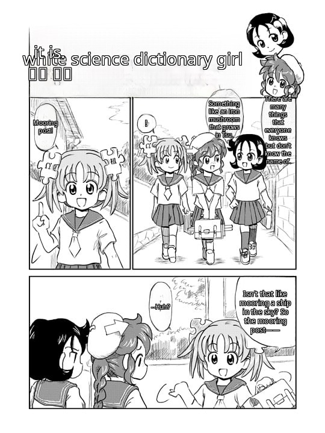

# comic-translate-4-free

言語： [English](../README.md) · [हिन्दी](README.hi.md) · [日本語](README.ja.md) · [한국어](README.ko.md) · [简体中文](README.zh-CN.md) · [繁體中文](README.zh-TW.md) · [Español](README.es.md) · [العربية](README.ar.md) · [Français](README.fr.md) · [বাংলা](README.bn.md) · [Português](README.pt.md) · [Русский](README.ru.md) · [Tiếng Việt](README.vi.md) · [Bahasa Indonesia](README.id.md) · [اردو](README.ur.md) · [Deutsch](README.de.md) · [Română](README.ro.md)

あなたの言語でマンガを読もう！
comic-translate-4-free はブラウジング中にマンガやコミックを自動で翻訳します。日本語、英語、簡体字/繁体字中国語を読み取り（自動検出）、114言語に翻訳し、画像をその場で置き換えます。

### 📸 ビフォア & アフター

| ビフォア（日本語） | アフター（英語） |
| --- | --- |
|  |  |

他の 14 言語への翻訳を見る

| ヒンディー語 | 韓国語 | 簡体字中国語 |
| --- | --- | --- |
|  |  |  |

| 繁体字中国語 | スペイン語 | アラビア語 |
| --- | --- | --- |
|  |  |  |

| フランス語 | ベンガル語 | ポルトガル語 |
| --- | --- | --- |
|  |  |  |

| ロシア語 | ベトナム語 | インドネシア語 |
| --- | --- | --- |
|  |  |  |

| ウルドゥー語 | ドイツ語 |
| --- | --- |
|  |  |

*Kasuga氏による Wikipe-tan の原画（[Wikipedia の Manga の記事](https://en.wikipedia.org/wiki/Manga)より、Wikimedia Commons 経由）— [CC BY-SA 3.0](https://creativecommons.org/licenses/by-sa/3.0/) の下でライセンスされています。翻訳後のスクリーンショットは、原画を改変した二次的著作物です。*

---

## ✨ 機能

- 自動翻訳 — 許可したサイトでマンガのページを開くと、翻訳版がその場に表示されます。ボタンを押す必要はありません。
- 任意の画像を右クリック — 「comic-translate-4-free に送信」を選ぶと、特定の画像を翻訳できます。最小サイズより小さい画像でも翻訳できます。
- 114 の対象言語 — Google Translate、Azure Translator、または自分のローカル LM Studio サーバーで 114 の対象言語に対応。
- ソース言語の自動検出 — OCR で読み取ったテキストから、日本語、英語、簡体字/繁体字中国語を自動で識別します。
- 縦長ストリップ / ウェブトゥーン対応 — 縦長のページは重なり合うセグメントで処理されるため、テキストがシャープなままです。
- 17 の UI 言語 — 拡張機能のインターフェースはブラウザの言語設定に従います。

### 🔒 プライバシー

- AI はあなたのコンピューター上で動作します。吹き出し検出、OCR、インペインティングはすべてブラウザ内でローカルに動作します。検出と OCR は WebAssembly で動作します。インペインティングは Chrome では GPU で動作し（WebAssembly にフォールバック）、Firefox では WebAssembly で動作します。あなたのページがデバイスから出ることは決してありません。
- 送信されるのは翻訳されたテキストだけです — 抽出された文字列だけが、あなたが選んだ翻訳サービス（Google / Azure / ローカルの LM Studio）に送られます。
- アカウント不要、トラッキングなし、テレメトリなし。すべての設定とキャッシュされたモデルはブラウザのローカルストレージに残ります。

---

## 🚀 インストール

Chrome / Edge / Brave:

[Chrome ウェブストアからインストール](https://chromewebstore.google.com/detail/pndooikgcenncdohfggodonniihplppj) — ワンクリックで、自動更新されます。

Firefox:

[Firefox Add-ons からインストール](https://addons.mozilla.org/en-US/firefox/addon/comic-translate-4-free/) — ワンクリックで、自動更新。

インストール後、設定ページを開いて「すべてのモデルをダウンロード」を一度クリックしてください（約 350 MB：検出器、OCR、インペインター）。ブラウザにキャッシュされ、バイトサイズで検証されます。

---

## 💡 使い方

1. まずサイトを許可する — 拡張機能のアイコンをクリックし、このサイトを許可を押します（またはすべてのサイトを許可を有効にします）。翻訳は、許可を与えた場所でのみ動作します。

   

2. マンガのページを再読み込みする — ページが読み込まれると自動で翻訳が始まります。右上のピルがライブの進捗を表示します（Capturing → Detecting → OCR → …）。
3. 完了 — ページの画像がその場で翻訳版に置き換わります。

ヒント：
- 任意の画像を右クリック → comic-translate-4-free に送信で、その画像だけを翻訳します。

  

- サイトがダウンロードをブロックする場合（HTTP 403）、拡張機能はバックグラウンドタブ経由で自動的に再試行します。
- 設定で翻訳エンジンを選んでください：Google（無料、キー不要）、Azure Translator（下記でキーを申請 — 月 200 万文字まで無料）、または LM Studio（ローカルサーバー）。
- 設定でデバッグモード（ステージ検査）を有効にすると、パイプラインの各段階を確認できます。

---

## 🔑 Microsoft Azure アカウントを申請する

Azure Translator を翻訳エンジンとして使用するには：

1. Microsoft/hotmail/Azure アカウントを作成/サインインする
2. Azure サブスクリプションを作成する
3. Azure Translator リソースを作成する
4. F0（無料）料金プランを選択する — 月 200 万文字、有効期限なし
5. リソース管理 → キーとエンドポイント → KEY 1 と Location/Region をコピーする
6. 拡張機能の設定ページに貼り付ける

---

## ❤️ このプロジェクトを支援する

この拡張機能が役に立つ場合は、開発の支援をご検討ください：

---

## ⚠️ 既知の問題

- 韓国語の OCR はまだありません — ソース言語は日本語、英語、簡体字/繁体字中国語です。（韓国語は翻訳対象言語として引き続き利用できます。）
- 自動翻訳は1 ページにつき 1 枚の画像です（ページのメイン画像）。他の画像は右クリック → 送信で翻訳してください。
- 大量のセッション — 1 回のセッションで数十枚の画像を翻訳すると、ブラウザがクラッシュすることがあります。その場合は設定でページキャッシュをクリアしてください。
- Firefox — モデルはバックグラウンドページで動作し（オフスクリーンドキュメントなし）、他のすべてとメモリを共有します。「no available backend found」と表示されたら、ブラウザを再起動してください。
- Firefox は Chrome より遅いです — Firefox 拡張機能はマルチスレッド用の共有メモリ（SharedArrayBuffer）を使用できないため、モデルは 1 つの CPU スレッドで動作します。これは拡張機能のバグではなく、Firefox プラットフォームの制限です。([Mozilla バグ 1673477](https://bugzilla.mozilla.org/show_bug.cgi?id=1673477))
- Google Translate は非公式の無料エンドポイントを使用しており、レート制限される場合があります。

---

## 📄 サードパーティに関する通知

このプロジェクトは [ogkalu2/comic-translate](https://github.com/ogkalu2/comic-translate) に着想を得ています — 吹き出し/テキスト検出器とマンガで学習した LaMa インペインターはその ONNX エクスポートであり、推論ロジックはそこから移植されています。（OCR は genshiai-daichi の [Baberu](https://huggingface.co/genshiai-daichi/baberu-ocr) を使用しています。）

バンドルされたライブラリ、移植されたコード、実行時にダウンロードされるモデルは、ライセンスとともに [THIRD-PARTY-NOTICES.md](../THIRD-PARTY-NOTICES.md) に記載されています。

MIT ライセンス — [LICENSE](../LICENSE) を参照。
