# comic-translate-4-free

Limba: [English](../README.md) · [हिन्दी](README.hi.md) · [日本語](README.ja.md) · [한국어](README.ko.md) · [简体中文](README.zh-CN.md) · [繁體中文](README.zh-TW.md) · [Español](README.es.md) · [العربية](README.ar.md) · [Français](README.fr.md) · [বাংলা](README.bn.md) · [Português](README.pt.md) · [Русский](README.ru.md) · [Tiếng Việt](README.vi.md) · [Bahasa Indonesia](README.id.md) · [اردو](README.ur.md) · [Deutsch](README.de.md) · [Română](README.ro.md)

Citește manga în limba ta!
comic-translate-4-free traduce automat manga și benzi desenate în timp ce navighezi. Citește japoneză, engleză, chineză simplificată/tradițională (detectare automată) și traduce în 114 limbi, înlocuind imaginea chiar acolo.

### 📸 Înainte și după

| Înainte (japoneză) | După (engleză) |
| --- | --- |
| 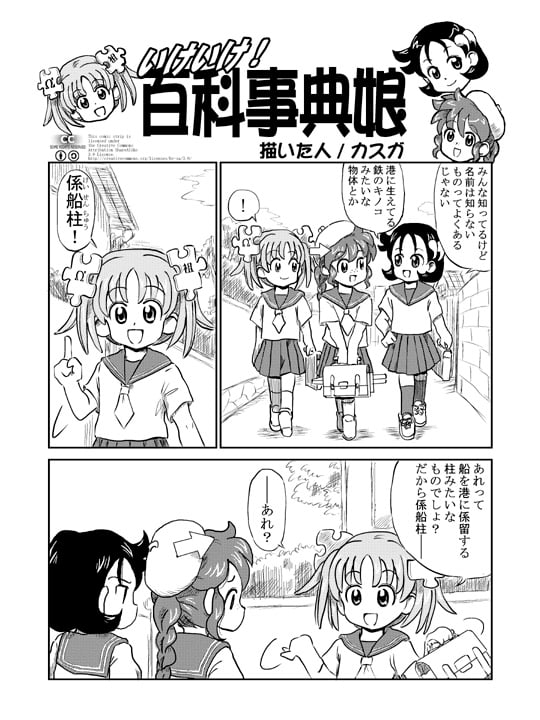 | 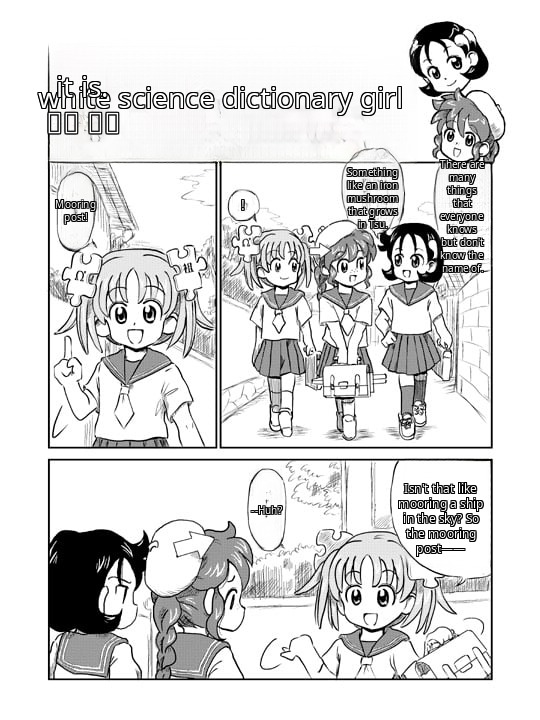 |

Vezi traducerile în alte 14 limbi

| Hindi | Korean | Simplified Chinese |
| --- | --- | --- |
| 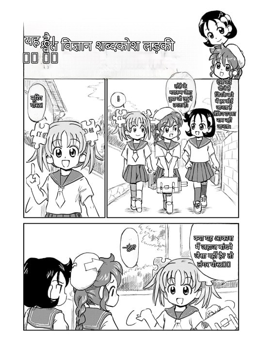 | 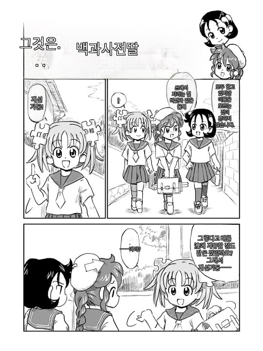 | 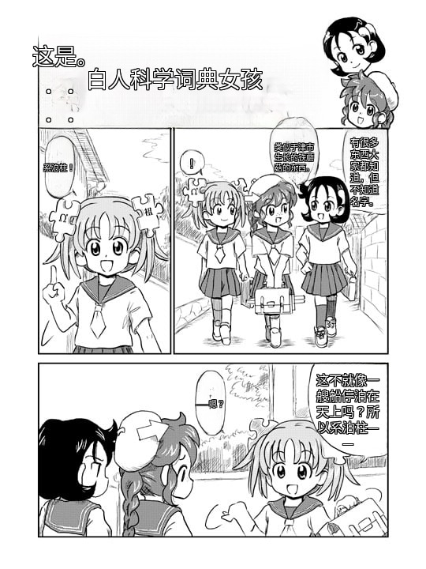 |

| Traditional Chinese | Spanish | Arabic |
| --- | --- | --- |
|  | 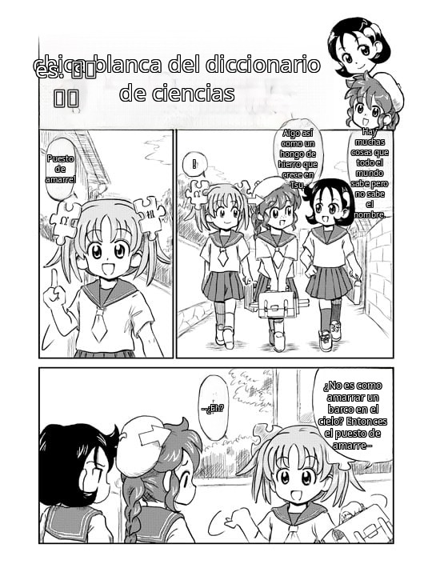 | 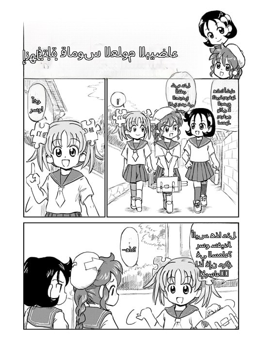 |

| French | Bengali | Portuguese |
| --- | --- | --- |
| 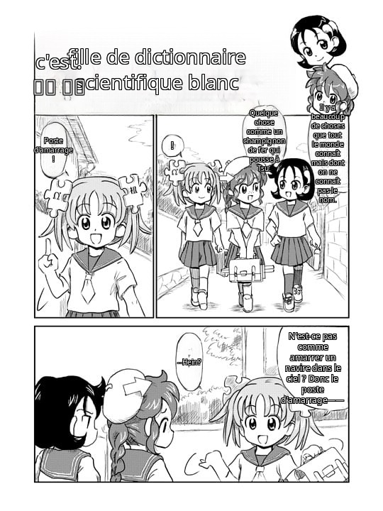 | 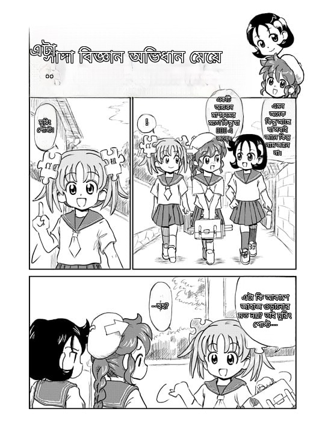 | 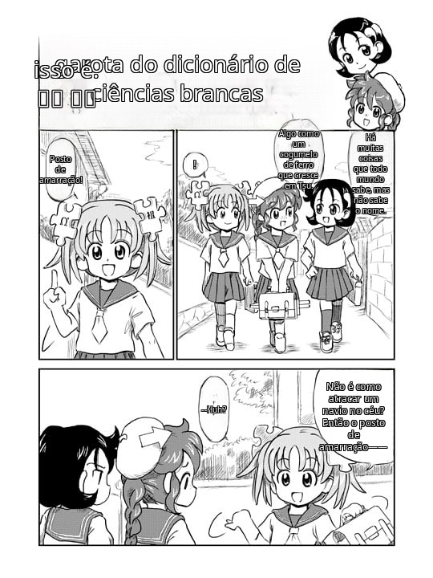 |

| Russian | Vietnamese | Indonesian |
| --- | --- | --- |
| 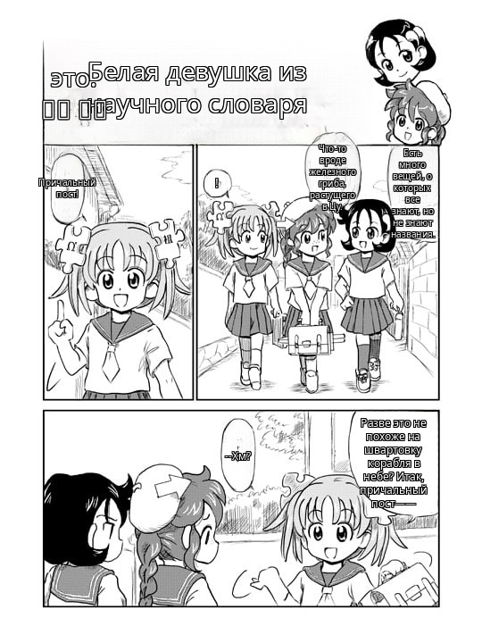 | 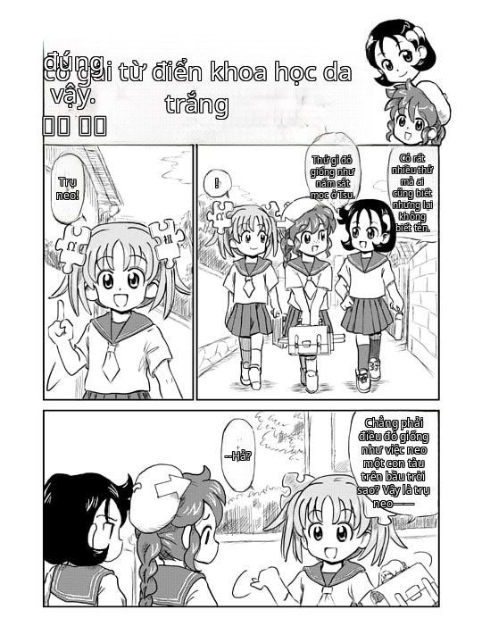 |  |

| Urdu | German |
| --- | --- |
|  | 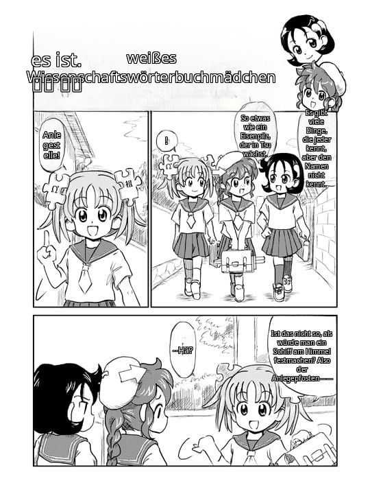 |

*Ilustrația originală Wikipe-tan de Kasuga, din [articolul Manga din Wikipedia](https://en.wikipedia.org/wiki/Manga) via Wikimedia Commons — licențiată sub [CC BY-SA 3.0](https://creativecommons.org/licenses/by-sa/3.0/). Capturile de ecran traduse sunt derivate modificate ale originalului.*

---

## ✨ Funcții

- Traducere automată — deschide o pagină de manga pe un site permis, iar versiunea tradusă apare chiar acolo, fără să fie nevoie să apeși vreun buton.
- Clic dreapta pe orice imagine — alege „Trimite la comic-translate-4-free” pentru a traduce o anumită imagine, chiar și una mai mică decât dimensiunea minimă.
- 114 limbi țintă prin Google Translate, Azure Translator sau propriul tău server local LM Studio.
- Detectare automată a limbii sursă — japoneza, engleza, chineza simplificată/tradițională sunt identificate automat din textul recunoscut prin OCR.
- Suport pentru benzi lungi / webtoon — paginile înalte sunt procesate în segmente care se suprapun, astfel încât textul rămâne clar.
- 17 limbi pentru interfață — interfața extensiei urmează setarea de limbă a browserului tău.

### 🔒 Confidențialitate

- AI-ul rulează pe calculatorul tău. Detectarea bulelor, OCR-ul și inpainting-ul rulează toate local, în browserul tău. Detectarea și OCR-ul rulează prin WebAssembly. Inpainting-ul rulează pe GPU în Chrome (cu revenire la WebAssembly), iar în Firefox prin WebAssembly. Paginile tale nu părăsesc niciodată dispozitivul tău.
- Doar textul tradus este trimis mai departe — doar șirurile de text extrase ajung la serviciul de traducere pe care îl alegi (Google / Azure / LM Studio local).
- Fără cont, fără urmărire, fără telemetrie. Toate setările și modelele stocate în cache rămân în stocarea locală a browserului tău.

---

## 🚀 Instalare

Chrome / Edge / Brave:

[Instalează din Chrome Web Store](https://chromewebstore.google.com/detail/pndooikgcenncdohfggodonniihplppj) — un clic, actualizări automate.

Firefox:

[Instalează din Firefox Add-ons](https://addons.mozilla.org/en-US/firefox/addon/comic-translate-4-free/) — un clic, actualizări automate.

După instalare, deschide pagina Setări și apasă o dată Descarcă toate modelele (~350 MB: detector, OCR, inpainter). Sunt stocate în cache în browser și verificate după dimensiunea în octeți.

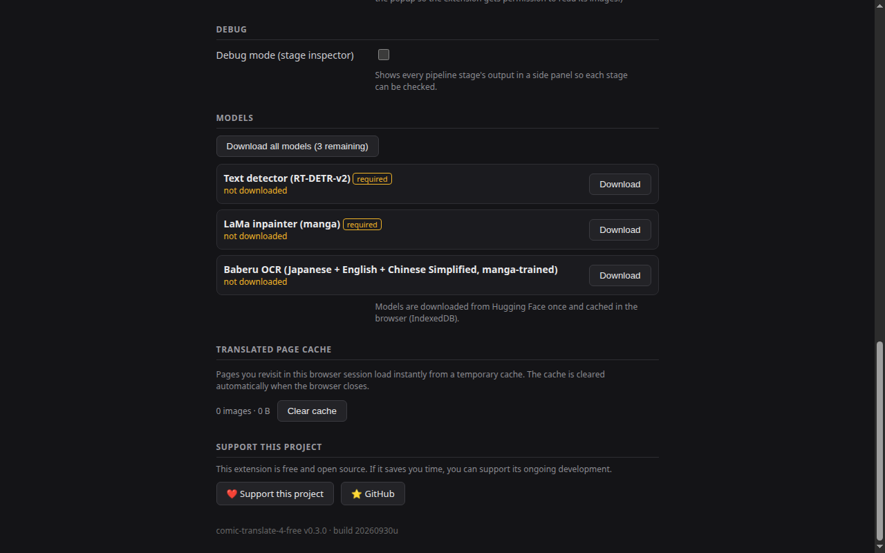

---

## 💡 Cum se folosește

1. Permite mai întâi site-ul — apasă pe pictograma extensiei și apasă Permite acest site (sau activează Permite toate site-urile). Traducerea rulează doar unde ai acordat permisiunea.

   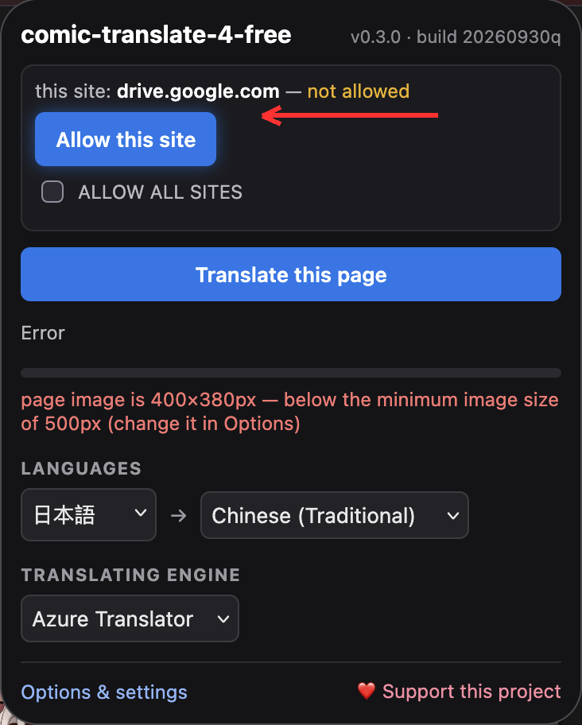

2. Reîncarcă pagina de manga — începe să traducă automat când se încarcă pagina. O bulină în colțul din dreapta sus arată progresul live (Capturing → Detecting → OCR → …).
3. Gata — imaginea paginii este înlocuită chiar acolo cu versiunea tradusă.

Sfaturi:
- Clic dreapta pe orice imagine → Trimite la comic-translate-4-free pentru a traduce doar acea imagine.

  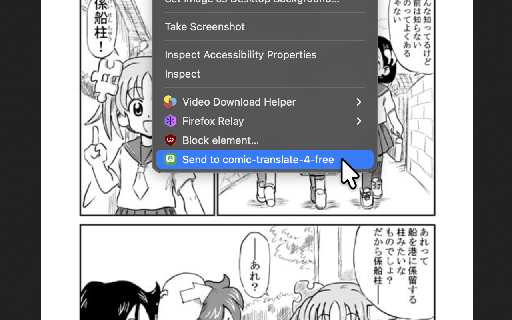

- Dacă un site blochează descărcările (HTTP 403), extensia încearcă din nou automat printr-o filă de fundal.
- Alege motorul de traducere în Setări: Google (gratuit, fără cheie), Azure Translator (cere chei mai jos — 2 milioane de caractere/lună gratuit), sau LM Studio (server local).
- Activează Mod depanare (inspector de etape) în Setări pentru a inspecta fiecare etapă a procesului.

---

## 🔑 Solicită un cont Microsoft Azure

Pentru a folosi Azure Translator ca motor de traducere:

1. Creează un cont Microsoft/hotmail/Azure sau autentifică-te
2. Creează un abonament Azure
3. Creează o resursă Azure Translator
4. Selectează nivelul de preț F0 (Gratuit) — 2 milioane de caractere/lună, nu expiră
5. Resource Management → Keys and Endpoint → copiază KEY 1 și Location/Region
6. Lipește-le în pagina Setări a extensiei

---

## ❤️ Sprijină acest proiect

Dacă această extensie îți este utilă, ia în considerare sprijinirea dezvoltării sale:

---

## ⚠️ Probleme cunoscute

- Încă nu există OCR pentru coreeană — limbile sursă sunt japoneza, engleza și chineza simplificată/tradițională. (Coreeana rămâne disponibilă ca limbă de traducere.)
- O singură imagine pe pagină pentru traducerea automată (imaginea principală a paginii). Folosește clic dreapta → Trimite pentru a traduce celelalte imagini.
- Sesiuni mari — traducerea a zeci de imagini într-o singură sesiune poate bloca browserul. Golește memoria cache a paginii în Setări, dacă se întâmplă acest lucru.
- Firefox — modelele rulează în pagina de fundal (fără documente offscreen), împărțind memoria cu toate celelalte. Repornește browserul dacă vezi mesajul „no available backend found”.
- Firefox este mai lent decât Chrome — extensiile Firefox nu pot folosi memoria partajată pentru multi-threading (SharedArrayBuffer), așa că modelul rulează pe un singur fir CPU. Aceasta este o limită a platformei Firefox, nu o eroare a extensiei. ([Bug Mozilla 1673477](https://bugzilla.mozilla.org/show_bug.cgi?id=1673477)).
- Google Translate folosește endpointul gratuit neoficial și poate fi limitat ca rată.

---

## 📄 Note privind terții

Acest proiect este inspirat de [ogkalu2/comic-translate](https://github.com/ogkalu2/comic-translate) — detectorul de bule/text și inpainterul LaMa antrenat pe manga sunt exporturile sale ONNX, iar logica de inferență este portată de acolo. (OCR-ul folosește [Baberu](https://huggingface.co/genshiai-daichi/baberu-ocr) de genshiai-daichi.)

Bibliotecile incluse, codul portat și modelele descărcate la rulare sunt listate cu licențele lor în [THIRD-PARTY-NOTICES.md](../THIRD-PARTY-NOTICES.md).

PolyForm Noncommercial License 1.0.0 — vezi [LICENSE](../LICENSE).
